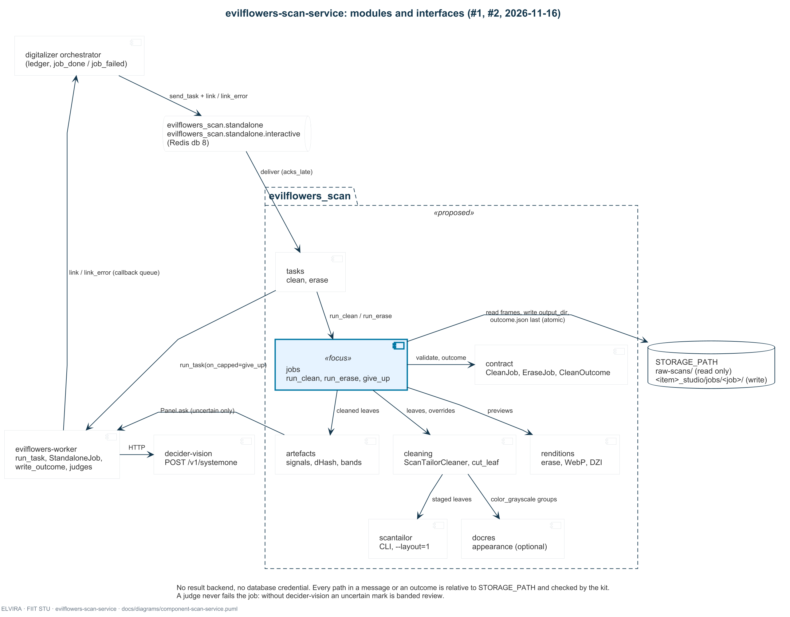
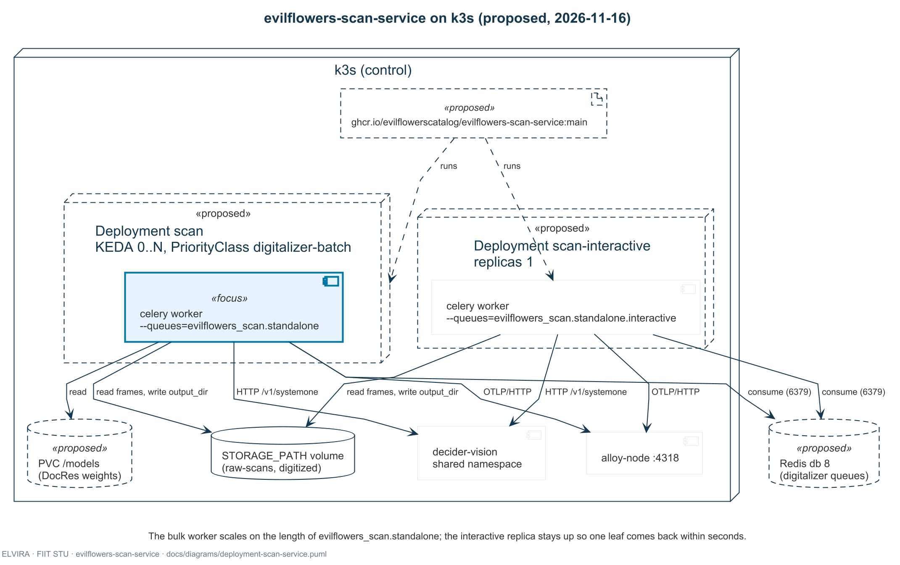

# evilflowers-scan-service

Page restoration for the books digitalizer: raw scan frames (TIFF, ~24 MB per page at 300 dpi RGB) → cleaned leaves,
WebP previews, Deep Zoom pyramids and a "real or artefact?" verdict for every mark. It runs as **standalone jobs** on
the shared worker kit ([evilflowers-worker](https://github.com/EvilFlowersCatalog/evilflowers-worker), §2): the
digitalizer's orchestrator is the system of record, this worker holds no database or catalog credential.



## Tasks

| Task | Queues (Redis db 8) | Message | Does |
|---|---|---|---|
| `evilflowers_scan.clean` | `evilflowers_scan.standalone` (bulk, ≤ 32 leaves), `evilflowers_scan.standalone.interactive` (one leaf) | `contract.CleanJob` | cut each planned leaf out of its frame, ScanTailor, optional DocRes, previews, DZI, marks (#1, #2) |
| `evilflowers_scan.erase` | the same | `contract.EraseJob` | paint confirmed `remove` boxes white on a copy, then the same renditions (#1) |

Message (keyword arguments, every path relative to `STORAGE_PATH`):

```json
{"run_id": "42", "job": "clean-0003-a1", "token": "…", "inputs": ["raw-scans/fei/<book>/0002.tif"],
 "output_dir": "digitized/<item>/<item>_studio/jobs/17-a1",
 "outcome": "digitized/<item>/<item>_studio/jobs/17-a1/outcome.json",
 "leaves": [{"leaf": 3, "frame": "raw-scans/fei/<book>/0002.tif", "side": 1, "crop_box": [x, y, w, h],
             "rotate_degree": 0, "hand_side": "RIGHT", "override": {}}],
 "erase_hidden": false}
```

What lands in `output_dir`:

```
0003.tif                  cleaned leaf (lossless: deflate, group4 when bitonal)
leaves/0003.webp          preview, longest side PREVIEW_PX
dzi/0003.dzi, dzi/0003_files/   Deep Zoom pyramid (OpenSeadragon)
outcome.json              last and atomic
```

Outcome (the orchestrator's `CleanOutcome`; it ignores fields it does not know yet):

```json
{"run_id": "42", "token": "…", "status": "done", "error": null,
 "leaves": [{"leaf": 3, "image": "…/0003.tif", "width": 2480, "height": 3508, "dpi": 600, "skew_deg": 0.0,
             "preview": "…/leaves/0003.webp", "dzi": "…/dzi/0003.dzi",
             "crop_box": [x, y, w, h], "rotate_degree": 0, "warnings": [],
             "marks": [{"bbox": [x0, y0, x1, y1], "category": "stamp", "p": 0.91, "band": "hide",
                        "model": "signals", "signals": {"position": "margin", "repeats": 5, "dhash": "…"}}]}]}
```

Rules ([sequence](docs/diagrams/sequence-scan-clean.png)):

- the frames are only read; nothing is written outside `output_dir` (ScanTailor stages in `output_dir/.st-*` and the
  staging is removed);
- the outcome is written last (temp file, rename); `run_id` and `token` are echoed;
- a failure writes `status: failed` with `error`, then raises: `link_error` fires; past `MAX_DELIVERIES` the same;
- a deliberate requeue (SIGTERM, scale-in) writes nothing: the redelivery carries the same token;
- the headers `digitalizer_run_id`, `digitalizer_job_id`, `digitalizer_stage`, `digitalizer_lane` go on spans and log
  lines.

### Overrides

`override` is the digitalizer's `PageOverride.as_dict()`: `crop` (`[x0, y0, x1, y1]`, wins over the plan),
`split_x` (moves the gutter edge of a spread half), `deskew_deg`, `despeckle`, `color_mode`. Leaves are grouped by
their effective `(color_mode, despeckle)`: ScanTailor's flags are per run.

### ScanTailor gotchas (kept from the digitalizer)

- `scantailor-deviant-cli`'s batch mode finds a spread's gutter but does not carry the cut into content detection. The
  service never lets it split: leaves arrive planned and are cut first, ScanTailor runs with `--layout=1`.
- Leptonica / ScanTailor choke on macOS's `/tmp` symlink: every path handed to the binary is resolved, and nothing is
  staged in `/tmp`.

## Artefact check (#2)

Library scans carry stamps, stickers, call-number labels, bleed-through, finger shadows and scan edges. Every cleaned
leaf is checked (`artefacts.py`):

1. **Signals, no model.** Saturated blue/violet/red ink (stamps), dark bands on a border followed by paper (edges),
   flat non-white rectangles (stickers), faint grey ink away from dark ink (bleed-through), and compact ink clusters
   outside the text block (a stamp binarized by ScanTailor's default `mixed` mode). Each is scored by its own signal,
   its position (margin or gutter: outside the detected text block) and a perceptual hash: the same mark on
   `ARTEFACT_MIN_REPEATS` leaves of a job is furniture. A mark found without colour is never hidden on signals alone
   (it may be a running head or an ornament).
2. **Bands.** `p ≥ ARTEFACT_SURE`: `hide` without a model. `p < ARTEFACT_FLOOR`: dropped. In between: a `choice`
   question to `decider-vision` (stamp, sticker, bleed_through, edge, content) through `evilflowers-worker[judges]`,
   within the job's budget, banded with `JUDGE_THRESHOLDS["scan_mark"]`. No judge, or no threshold: `review`
   (a disputed region in the page studio).
3. **Nothing is erased** unless the message sets `erase_hidden` (the project enables it): then `hide` marks are painted
   white before the renditions.

Metrics: `scan_marks_total{category,band}` for every mark, and the kit's `scan_judge_total{question,outcome,band}` and
`scan_judge_seconds` for the judge calls.

Known limits: repetition is counted within one job (≤ 32 leaves; an interactive job has one leaf, so no furniture
there; every mark carries its `dhash` so the orchestrator can count across a book). In `mixed` mode a mark smaller
than 4 % of the page's shorter side (about 6 mm) is not found. A failing check never fails the clean: the leaves get a
warning and no marks.

## Configuration

Every variable is optional; see `.env.sample`. The kit's own (`REDIS_URL`, `STORAGE_PATH`, `MAX_DELIVERIES`,
`WORKER_SOFT_SHUTDOWN_TIMEOUT`, …) and the judges' (`JUDGES_ENABLED`, `DECIDER_VISION_URL`, `JUDGE_THRESHOLDS`, …) are
documented in evilflowers-worker.

## Development

```bash
make install        # uv sync: core + dev
make check          # ruff + pytest
make worker         # a local worker of the bulk queue (needs Redis and STORAGE_PATH)
```

The tests run ScanTailor for real when `scantailor-deviant-cli` is on `PATH` and skip those cases otherwise (CI has no
ScanTailor; the image does). `tests/test_end_to_end.py` runs a real worker against Redis (`TEST_REDIS_URL`, default
`redis://localhost:6379/15`): skipped without Redis locally, a failure in CI. On macOS run a local worker with
`--pool=solo` (evilflowers-worker README).

## Deployment



CI builds `ghcr.io/evilflowerscatalog/evilflowers-scan-service` (`:main`, `:sha-…`) after the tests pass against a real
Redis. The k3s side (two Deployments, KEDA on the bulk queue, PriorityClass `digitalizer-batch`, the `/models` PVC)
lives in evilflowers-knowledge's Ansible.
